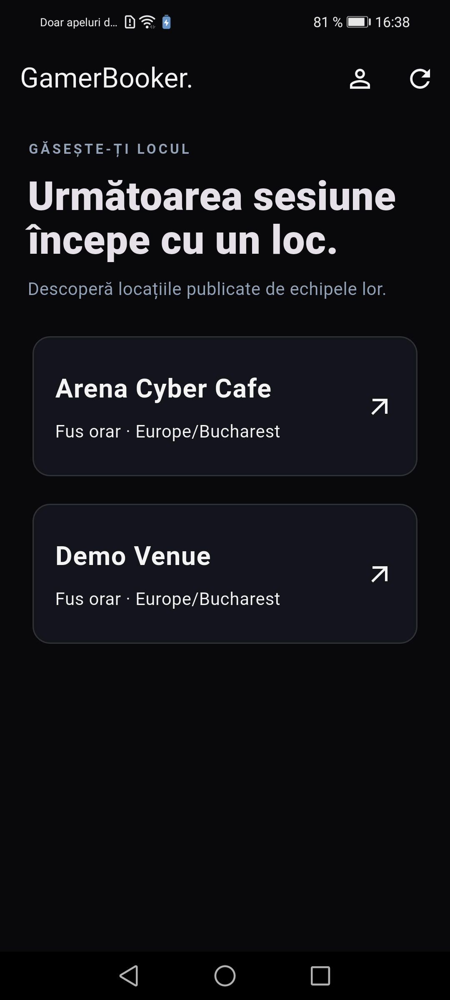
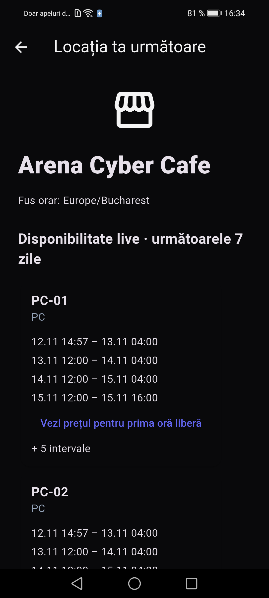
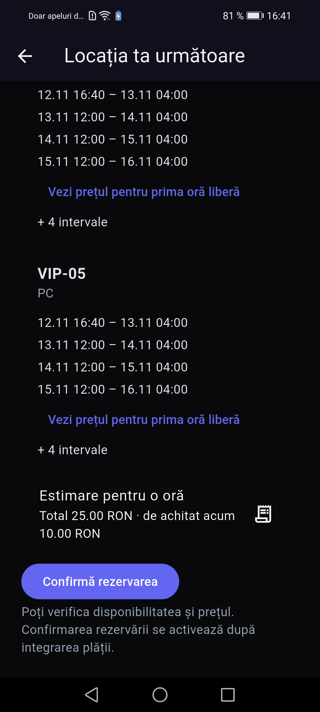
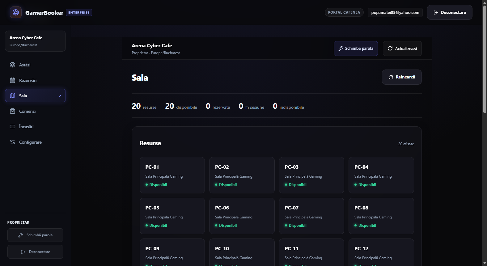
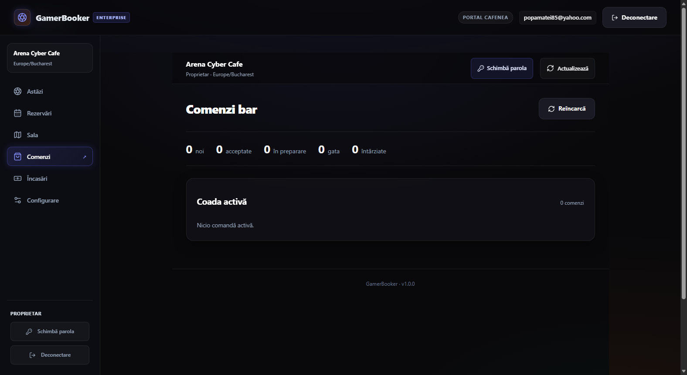
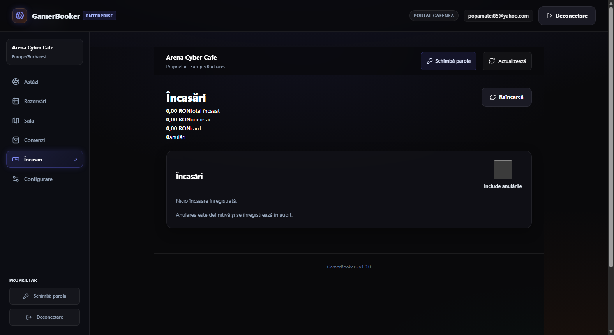
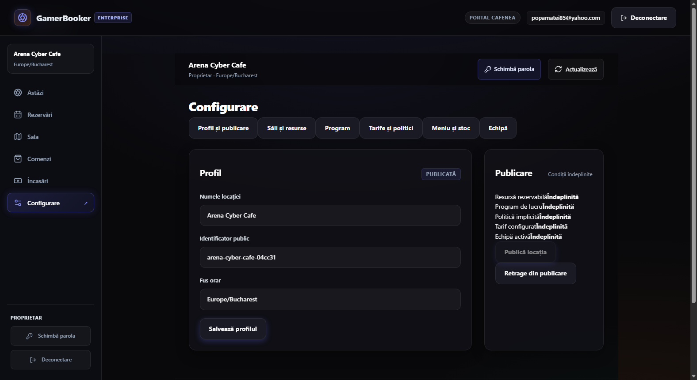
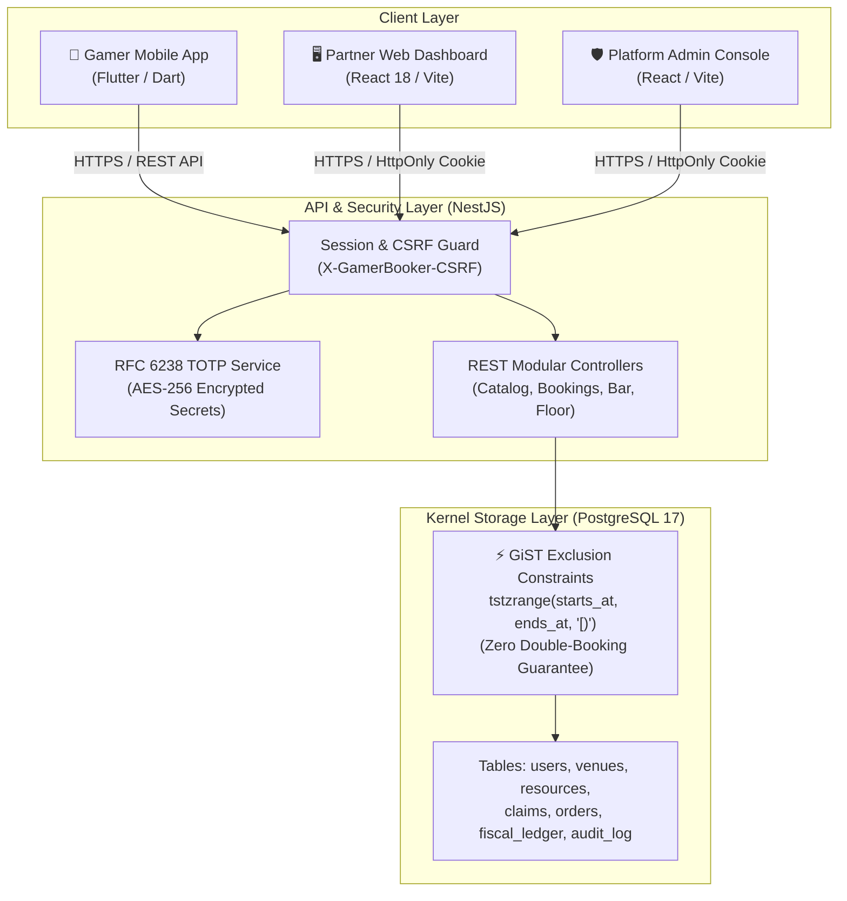
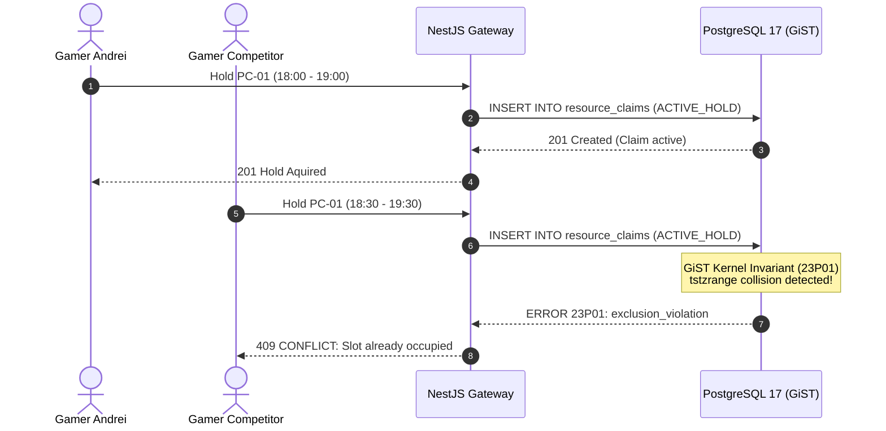

# 🎮 GamerBooker Enterprise v1.0

<div align="center">


<p align="center">
  <strong>The Next-Generation Operating System for Internet Cafes, Gaming Lounges & Esports Arenas</strong>
</p>

<p align="center">
  <a href="#-overview">Overview</a> •
  <a href="#-key-features">Key Features</a> •
  <a href="#-visual-tour">Visual Tour</a> •
  <a href="#-system-architecture">Architecture</a> •
  <a href="#-under-the-hood-enterprise-invariants">Under The Hood</a> •
  <a href="#-getting-started">Getting Started</a> •
  <a href="#-testing--verification">Testing</a> •
  <a href="#-presentation">Deck</a>
</p>

---

</div>

## 📌 Overview

**GamerBooker Enterprise** is a high-availability, multi-tenant booking, management, and point-of-sale platform specifically engineered for gaming arenas, internet cafes, and esports centers. 

It replaces manual, error-prone operations (phone calls, WhatsApp messages, notebook tracking, no-shows, and cash-drawer discrepancies) with a seamless, cloud-connected digital ecosystem:

- **For Gamers**: An intuitive mobile app to discover venues, inspect live 7-day PC availability, lock seats with micro-deposits, check in via rotating QR boarding passes, and order bar snacks directly to their station without pausing the game.
- **For Cafe Owners & Staff**: A high-productivity real-time web command center providing a 20+ PC live floor map, one-click maintenance blocks, a live bar order queue, fiscal receipt ledgers, and dynamic 7-day schedule/pricing controls.
- **For Platform Operators**: Multi-tenant isolation, automated publication verification gates, and tamper-proof audit trails.

---

## ⚡ Key Features

### 📱 1. Gamer Mobile Experience (Flutter)
- **Live 7-Day Availability Matrix**: Minute-accurate free/occupied intervals across all standard and VIP stations.
- **Signed Price Quotes & Atomic Holds**: Transparent breakdown (total price, required deposit, remaining balance) protected by cryptographic signatures.
- **Dynamic Digital Boarding Pass**: Rotating HMAC-SHA256 QR codes (refreshing every 15s) that prevent screenshot reuse and fraudulent access.
- **In-Session Bar Ordering**: Gamers can order energy drinks and snacks directly to their PC without getting up.

### 🖥️ 2. Partner Venue Dashboard (React 18 + Vite)
- **Tab 1: Sală (Live Floor View)**: Interactive station grid showing live statuses (`Disponibil`, `Rezervat`, `În sesiune`, `Mentenanță`). Immediate maintenance toggles instantly sync across all connected mobile clients.
- **Tab 2: Comenzi Bar (Fulfillment Board)**: Real-time order pipeline (`ACCEPTED` ➔ `PREPARING` ➔ `READY` ➔ `HANDED_OFF`).
- **Tab 3: Încasări (Financial Ledger)**: Instant revenue reconciliation, split by cash, card, and retained cancellation deposits.
- **Tab 4: Configurare (Venue Engine)**: 7-day operating hours, dynamic hourly/overnight pricing tiers, cancellation refund policies, bar stock catalog, and staff access roles.

### ⚙️ 3. Core Backend Engine (NestJS + PostgreSQL 17)
- **Mathematical Double-Booking Immunity**: Enforced at the database kernel level using PostgreSQL GiST temporal range exclusion constraints (`tstzrange`).
- **Banking-Grade Access Security**: Mandatory `X-GamerBooker-CSRF` validation on state-mutating requests, HttpOnly session cookies, and RFC 6238 TOTP hardware-grade multi-factor authentication.
- **Automated Publication Gates**: 5/5 strict validation gates (resources, schedule, pricing, cancellation policy, active staff) verified before a venue can go live.

---

## 📸 Visual Tour

### 📱 Mobile Experience (Flutter)

| 1. Descoperire Săli | 2. Disponibilitate Live 7 Zile | 3. Calcul Ofertă & Avans |
|:---:|:---:|:---:|
|  |  |  |
| *Identificare locații & orar* | *Ferestre libere per PC (PC-01..PC-20)* | *Calcul avans (25 RON / 10 RON)* |

---

### 🖥️ Partner Venue Dashboard (React 18)

#### Tab 1: Sală · Harta Calculatoarelor în Timp Real
Monitorizare simultană a celor 20 de stații de gaming cu statusuri colorate și blocare mentenanță la 1 click:


#### Tab 2: Comenzi Bar & Tab 3: Încasări Fiscale
Gestionare comenzi băuturi primite de la gameri și rapoarte financiare automatizate:
| Comenzi Bar (Pipeline Live) | Încasări & Reconciliere Fiscală |
|:---:|:---:|
|  |  |

#### Tab 4: Configurare Locație & Porți de Publicare
Orar săptămânal, tarife orare, politici de anulare și catalog bar:


---

## 🏗️ System Architecture



---

## 🔬 Under The Hood: Enterprise Invariants

### 1. PostgreSQL GiST Kernel Exclusion Invariant
In high-traffic environments, application-level checks (`SELECT ... WHERE NOT EXISTS ...`) suffer from race conditions. GamerBooker enforces non-overlapping reservation claims directly inside the PostgreSQL kernel:

```sql
ALTER TABLE resource_claims
  ADD CONSTRAINT no_overlapping_active_claims
  EXCLUDE USING gist (
    resource_id WITH =,
    tstzrange(starts_at, ends_at, '[)') WITH &&
  )
  WHERE (state IN ('ACTIVE_HOLD', 'CONFIRMED'));
```



### 2. Rotating HMAC QR Boarding Pass
Static QR codes can be easily captured via screenshot and forwarded or resold. GamerBooker generates dynamic HMAC tokens:
- **Seed**: Station ID + Booking Reference + Master Secret
- **Window**: Current epoch rounded to 15 seconds
- **Verification**: Cafe scanners accept only `T` and `T-1` windows. A forwarded screenshot expires within seconds.

---

## 🚀 Getting Started

### Prerequisites
- **Node.js**: v20+ LTS
- **PostgreSQL**: v17+ (with `btree_gist` extension enabled)
- **Flutter SDK**: v3.24+ (for mobile app)
- **Operating System**: Windows, macOS, or Linux

### 1. Repository Setup & Dependencies
```bash
# Clone the repository
git clone https://github.com/AlexMatei1/GamerBooker-Enterprise.git
cd GamerBooker-Enterprise

# Install root dependencies
npm install

# Install dashboard dependencies
npm --prefix apps/venue-dashboard install
```

### 2. Database Setup
```bash
# Ensure PostgreSQL is running on port 5433 (or update .env)
# Run migrations:
npm run db:migrate
```

### 3. Environment Configuration
Copy the production example configuration:
```bash
cp .env.production.example .env
```
Key variables to verify in `.env`:
```ini
PORT=3000
API_HOST=127.0.0.1
DATABASE_URL=postgresql://gamerbooker_app@127.0.0.1:5433/gamerbooker_dev
DASHBOARD_ORIGINS=http://localhost:5173,http://127.0.0.1:5173
```

### 4. Running the Ecosystem

#### Backend API Server:
```bash
node tools/local-auth/start-api.cjs start
# API available at: http://127.0.0.1:3000
# Health check: http://127.0.0.1:3000/healthz
```

#### Partner Venue Dashboard:
```bash
npm --prefix apps/venue-dashboard run dev
# Dashboard available at: http://localhost:5173
```

#### Turnkey Windows Launchers (1-Click):
- `porneste-tot.bat` — Automatically starts PostgreSQL 17, NestJS API, Venue Dashboard, and ADB reverse forwarding in background daemons.
- `demo-totp.bat` — Instant 6-digit TOTP MFA code generator for cafe owner login.

---

## 🧪 Testing & Verification

GamerBooker Enterprise includes an exhaustive automated battery covering Security/RBAC, Floor Operations, GiST Concurrency, Bar Ordering, and Anomaly bounds.

```bash
# Run automated test suite
npm test
```

### Master Battery Test Summary:
| Test Category | Tests Executed | Status |
|:---|:---:|:---:|
| **Security, CSRF & RBAC** | 5 / 5 | ✅ PASS |
| **Platform Admin & Intake Gates** | 2 / 2 | ✅ PASS |
| **Partner Dashboard (All 4 Tabs)** | 10 / 10 | ✅ PASS |
| **Mobile API & GiST Concurrency Lock** | 12 / 12 | ✅ PASS |
| **Boundary & Anomaly Rejection** | 2 / 2 | ✅ PASS |
| **Total Automated Master Battery** | **58 / 58** | **✅ 100% SUCCESS** |

*In addition to automated tests, full interactive end-to-end verification was performed on a physical Android 10 smartphone (`Huawei P smart 2021` - PPA-LX2).*

---

## 📊 Presentation Deck

A 10-slide, 16:9 widescreen PowerPoint pitch deck is available directly in the repository:
- 📁 **[docs/GamerBooker_Enterprise_Prezentare.pptx](docs/GamerBooker_Enterprise_Prezentare.pptx)**

---

## 📄 License & Credits

Developed with precision for the modern gaming entertainment industry.
Built by the **GamerBooker Engineering Team** (Alex Matei).

All rights reserved © 2026 GamerBooker.
