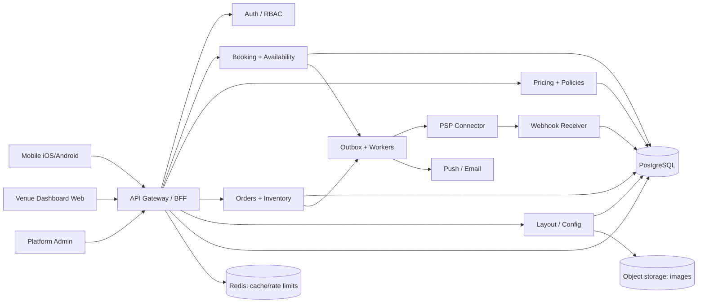

# Arhitectură de sistem — implementare recomandată [PROPOSED]

## Stil
**Modular monolith cu granițe de domeniu**, nu microservicii prematur. Un backend tranzacțional pentru inventory/booking/payment cu PostgreSQL ca source of truth; mesagerie outbox + worker pentru notificări și sync extern.

## Stack concret propus
- Mobile: React Native + TypeScript (alternativ Flutter); linkuri app/deep-link/QR.
- Dashboard: Next.js/React + TypeScript, canvas de layout cu library 2D robustă; preview read-only public.
- Backend: NestJS/TypeScript sau framework echivalent, OpenAPI, validation schema, RBAC.
- DB: PostgreSQL 16+ cu range constraints, migrations, row/tenant guard; Redis doar pentru cache/rate-limit, **nu** sursă pentru bookings sau sold.
- Background processing: Postgres outbox + job worker, retry with backoff; apoi queue dedicată la volum.
- Blob: object storage privat pentru fotografii și revizii; CDN și signed uploads.
- PSP: interfață adaptor `PaymentProvider` pentru suport marketplace/payouts/refunds, de ales conform disponibilității comerciale în România.

## Module și ownership
| Modul | Deține | Nu deține |
|---|---|---|
| Identity | accounts, sessions, memberships | booking status |
| Venue Config | tenant, venue, room, zone, overrides | payment balance |
| Layout | shapes, geometry, revisions | physical station booking status |
| Inventory | resources, includes/private-room topology | price quote |
| Pricing | tariffs, promotions, immutable quotes | PSP charge |
| Booking | holds, allocations, booking lifecycle | reconciliation |
| Payments | payment intents, ledger, refunds, receivables | available seats |
| Orders | products, stock reservations, order states | booking hold |
| Check-in | QR tokens, validated attendance, staff actions | app installation |
| Notifications | templates and delivery logs | business truth |
| Platform Admin | venue approval, audit investigations | personal booking creation |

## Tranzacții critice
- Availability + hold în **o singură tranzacție SQL** ce protejează overlap.
- Confirmare numai când Payment module produce `all_due_now_satisfied` și hold încă valid. Dacă PSP callback întârzie după expirare, plata este rambursată/reconciliată, **nu** reînviază rezervarea.
- Checkout group: tiparul quote→hold→shares→payment intents→all-paid→confirm.
- Outbox events se publică după commit; consumatorii idempotenti.

## Boundaries
`UI -> API -> domain services -> repository -> database`. Nu acceptăm calcule de preț trimise de mobil, state transitions arbitrare sau write direct client→Firestore. Niciun client nu setează `paid=true`.

## Scenarii degradate
- PSP indisponibil: checkout nu confirmă rezervări neachitate; se poate consulta catalog/calendar din cache etichetat.
- Push indisponibil: booking valid rămâne vizibil în app; notificarea se reîncearcă.
- Venue dashboard offline: fără confirmarea situației fizice, sistemul nu pretinde occupancy live.
- DB inaccesibil: fail closed pentru booking/platâ; niciodată acceptare offline optimistă.
