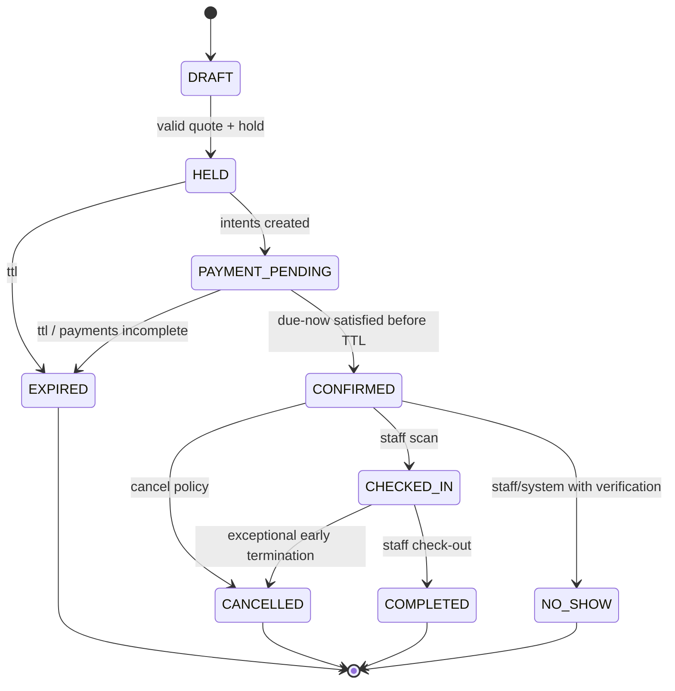

# Ciclu de viață: rezervare și sesiune

## State machine

**Notă:** refund/settlement sunt mașini de stare distincte; o rezervare anulată poate avea refund PENDING. `payment_status` nu se derivă automat din `booking_status`.

## Tranziții și gărzi
| From→To | Actor | Verificări | Evenimente |
|---|---|---|---|
| DRAFT→HELD | Client/API | valid auth, quote, claims; TTL | HoldCreated |
| HELD→PAYMENT_PENDING | Server | participant shares sum & intents | PaymentRequested |
| PAYMENT_PENDING→CONFIRMED | Server | all due-now captured, hold active, reconciliation check | BookingConfirmed |
| HELD/PAYMENT_PENDING→EXPIRED | Worker | server time >= TTL; claims release; paid refunds | HoldExpired, RefundRequested |
| CONFIRMED→CHECKED_IN | Staff | same venue, valid QR, allowed window, payment conditions | CheckedIn |
| CONFIRMED→CANCELLED | Client/authorized staff | snapshot policy, refunds | BookingCancelled |
| CONFIRMED→NO_SHOW | Staff + guarded automation | grace + evidence/manual confirmation | BookingNoShow |
| CHECKED_IN→COMPLETED | Staff | session concluded, remaining balance treatment | BookingCompleted |

## Booking structure
- `booking_id`, `public_code`, `venue_id`, `customer_id`, `type=SINGLE|GROUP`, `start_at`, `end_at`, `timezone`, `resource_assignments`.
- `price_snapshot`: unit rates, packages, discounts, taxes if applicable, total, due_now, remaining, currency.
- `policy_snapshot`: deposit rule, cancel cutoff, late cancellation penalty, no-show, grace, reschedule, late arrival, minimum durations.
- `group_snapshot`: participants, share splits, payer strategy, all-paid confirmation time.
- `version` optimistic concurrency; `created_at`, `confirmed_at`, actor audit.

## Durate
- Exemplar per sală: minim `60 min`, granularity `15/30/60 min`, max configurat. Verificarea este server-side.
- Dacă clientul rezervă 18:00–19:00 și următoarea sesiune începe la 19:00, prelungirea 30m nu este disponibilă.

## Check-in
- QR = cod cu ID public opac și nonce scurt expirabil, validat server; niciun token de plată sau PII în QR.
- Staff scanează pentru booking confirmat, venue matching, interval permis, verifică starea fizică. Re-scan produce `ALREADY_CHECKED_IN`, nu încă un consum monetar.
- Fără agent PC, `CHECKED_IN` confirmă prezența, nu pornirea efectivă a calculatorului.

## Late arrival, no-show
- Grace 15m [PROPOSED]. După grace, status devine `NO_SHOW_CANDIDATE`, nu eliberează automat un PC care poate fi fizic ocupat; staff confirmă.
- Penalitatea este cea din snapshot-ul de rezervare; verificare juridică înainte de a activa rețineri.
- Staff poate efectua manual check-in tardiv numai conform politicii și cu audit.

## Erori și compensare
- PSP paid dar hold expirat: refund request + status `PAYMENT_UNASSIGNED`, fără booking confirmat.
- Staff închide booking cu rest restant: se marchează `PAYMENT_DUE` și se declanșează workflow de recuperare/închidere permisă, fără ștergerea datoriei.
- Deconectare mobil după plata: backend persistă status; clientul poate vedea starea la relansare. Nu repornim payment blind.
