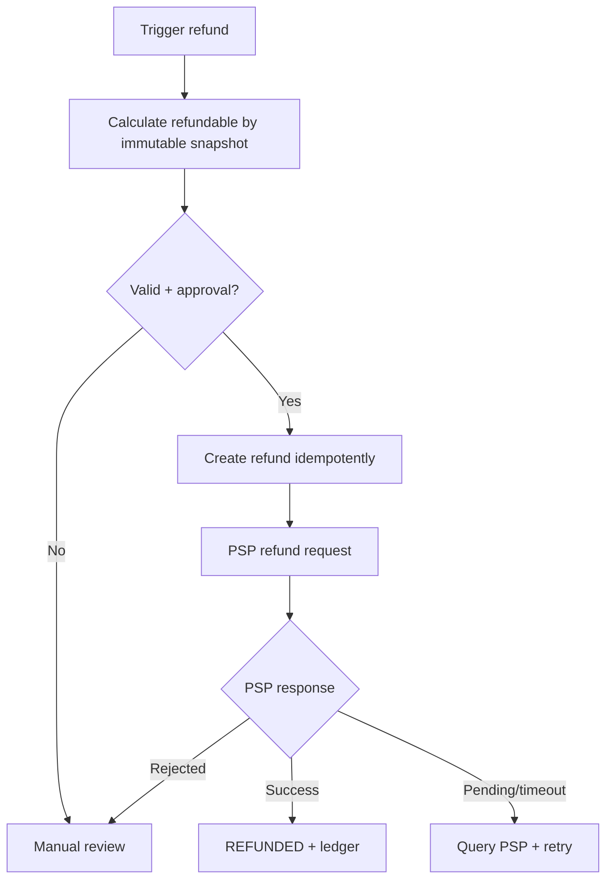

# Rambursări, dispute și reconciliere

## Trigger-uri
- Expirare checkout grup cu plăți parțiale deja capturate.
- Anulare în perioada gratuită sau anulare tardivă cu penalitate definită.
- Defect al echipamentului, venue cancellation, comandă indisponibilă.
- Overpayment, duplicare PSP, chargeback/refund disputat.

## Flux refund

## State machine refund
`REQUESTED → APPROVED → SUBMITTED → SUCCEEDED | FAILED_RETRYABLE | MANUAL_REVIEW`; `FAILED_RETRYABLE` revine la `SUBMITTED`, cu retry policy. `SUCCEEDED` numai după provider confirmation sau probă reconciliată.

## Reguli
- Sumă rambursată <= sumă efectiv încasată și nerambursată; verificare sub DB lock.
- Pentru booking grup, refund-ul este mapat la plătitorul original și payment intent original, nu automat la organizator.
- Consumabile neridicate/neîncasate: politica distinctă față de gaming; produs predat nu poate fi „refunded” automat fără return/reason.
- Taxele procesatorului și comisioanele trebuie separate din booking principal; societățile comerciale sunt responsabile de documentele fiscale conforme.

## Reconciliere zilnică
1. Import/consulta provider captured/refunded/chargeback.
2. Compare fiecare `provider_ref` cu `payment_intents` și ledger.
3. Compare offline receipts cu raportul casei/POS al sălii, cu semnătura unui angajat autorizat.
4. Detect orphan funds, refund pending, duplication, mismatch, fee discrepancies.
5. Generează report cu `opening balance, captures, refunds, fees, disputes, payout, closing expected`.
6. Investigare & compensating entries; niciun manual UPDATE pentru a face rapoartele să pară egale.

## Situații sensibile
- Provider refunded dar backend timeout: query status și ledger `SUCCEEDED` o singură dată.
- Booking cancel și produs deja livrat: doar serviciul gaming eligibil primește refund automat; consumabilele rămân consumate.
- Split partial paid expired: toate intențiile capturate intră în refund și se urmăresc până la finalizare.
- Chargeback pentru booking onorat: evidența booking păstrată, cont dispute separat, staff nu schimbă manual statusul plății în paid.

## Settlement și merchant-of-record [LEGAL-REVIEW]
PSP/merchant contract trebuie să clarifice: entitatea care încasează pentru serviciul prestat, cine emite factura/bonul, cum se repartizează sumele, cine suportă chargeback, KYC/AML și timpul de decontare. Varianta multi-merchant nu se presupune implementabilă fără validare cu furnizorul.
