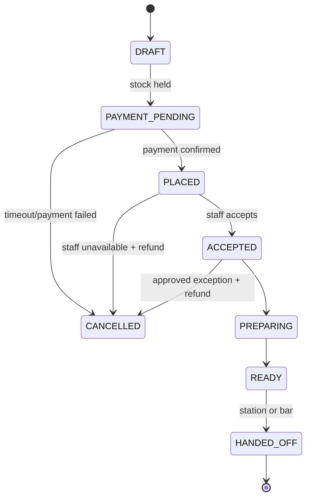

# Consumables — order lifecycle, plată și predare

## Când se poate comanda
- La checkout booking (preorder) cu confirmare dependentă de booking.
- În timpul sesiunii pentru booking `CONFIRMED|CHECKED_IN` conform ferestrei configurate, de exemplu preorders până X minute înainte de start și live orders până Y minute înainte de închidere [PROPOSED].
- Un client nu poate folosi doar componenta de comenzi fără rezervare relevantă; GamerBooker rămâne reservation-first.

## Fulfillment modes [CONFIRMED]
`AT_STATION`, `BAR_PICKUP`; venue publică metodele permise. Pentru `AT_STATION`, target resource este identificat prin booking assignment; clientul alege participantul/stația în grup. `BAR_PICKUP` oferă cod de ridicare.

## States

Refund status este separat de order status; un order CANCELLED cu PSP refund pending rămâne evidențiat ca atare.

## Employee actions
- Bar staff `accept`, `mark_preparing`, `mark_ready`, `handoff`, `reject` cu reason; indicator pentru SLA depășit.
- La predare se verifică identitatea booking/QR/cod și, pentru produse restricționate, eligibilitate legală.
- Inventar decrementează conform politicii la handoff ori accept, cu stock movement audit.

## Preorder + booking cancellation
- Dacă booking expiră înainte de confirmare → orice comandă dependentă nu este plătită/capturată sau se compensează.
- Dacă booking e anulată și produse încă nepregătite → se aplică refund policy pentru produse; dacă deja predate, nu se rambursează automat.
- Mutați comanda către resursa nouă după reschedule numai dacă modul de predare și starea permit; actualizați target with audit.

## Edge cases
- Client plătește după ultimul produs din stoc a fost deja luat: stock lock previne supravânzarea; PSP late success refund.
- Staff apasă handoff de două ori: idempotent, nu dublăm stock movement.
- Produs epuizat după acceptare: clientul aprobă substitute price difference, altfel refund. Nu înlocuim automat.
- Server indisponibil: order placement fail closed; staff nu falsifică paid status.
- Clientul pleacă înainte de ridicare: no-show/comandă neridicată cu policy proprie acceptată înainte, nu confiscare implicită.

## Exemple de comenzi
- Single booking PC-A1 → cola 8 RON la PC-A1.
- Group booking PC A1–A5 → 5 produse în aceeași sesiune, cu 5 payment lines/targets; nicio informație de card a participanților în dashboard.
- Private room → predare la intrarea camerei sau la bar, configurat.

## KPIs
Prep median, order age by state, fulfillment correctness, refund % și stock discrepancy.
